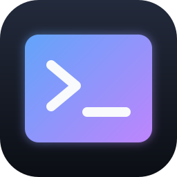

<div align="center">



# ssm-access

**Reach your EC2 instances with no open ports and no SSH keys stored on them. `ssh`, `scp` and VS Code still work.**

[](versions.tf)
[](cloudformation/ssm-access.yaml)
[](tests)
[](LICENSE)

<br>


<sub>Recorded against a fake AWS CLI, so no AWS account is needed. Try it with <code>make demo</code>.</sub>

</div>

## ✨ What it does

- **No open ports.** Security groups have no inbound rules and instances need no public IP.
- **Encrypted, recorded sessions.** Every session is encrypted and its transcript is saved to CloudWatch Logs.
- **Access is an IAM decision.** People can only start approved session types, and can be limited to instances with a certain tag.
- **SSH for the tools that need it.** `ssm-ssh` makes `ssh`, `scp`, `rsync` and VS Code Remote-SSH work, with a key the instance accepts for 60 seconds.
- **Optional extras:** automatic Systems Manager coverage for every instance, private endpoints for subnets with no NAT gateway, and a private jump host.

Part of [aws-security-toolkit](https://github.com/simar-s2/aws-security-toolkit), and works on its own.

<a name="run-it"></a>
## ⚡️ Run it

Deploy it to your account:

```bash
git clone https://github.com/simar-s2/ssm-access && cd ssm-access
scripts/deploy.sh --profile my-account --regions us-east-1,us-west-2 \
  --param EnableDefaultHostManagement=true
```

Then connect, with the AWS CLI v2 and the [Session Manager plugin](https://docs.aws.amazon.com/systems-manager/latest/userguide/session-manager-working-with-install-plugin.html):

```bash
aws ssm start-session --target i-0123456789abcdef0    # a shell

install -m 755 bin/ssm-ssh ~/.local/bin/              # or SSH, and VS Code Remote-SSH
ssm-ssh config dev-box i-0123456789abcdef0 --profile dev >> ~/.ssh/config
ssh dev-box
```

Terraform, port forwarding and every option: [docs/SETUP.md](docs/SETUP.md).

## 🔬 How it works

The agent on each instance makes an outbound HTTPS connection to AWS Systems Manager, and your session runs over it, so nothing has to accept connections from outside.

For SSH, `ssm-ssh` sends your public key to the instance with EC2 Instance Connect, then opens a tunnel through Session Manager. The instance accepts the key for 60 seconds, and nothing is written to `authorized_keys`.

The architecture diagrams and the choices I made: [docs/DESIGN.md](docs/DESIGN.md).

## 💰 Cost

Session Manager and EC2 Instance Connect are free. You pay about $1 a month per region for the encryption key, plus a small amount for CloudWatch Logs. The optional private endpoints add up: five in two Availability Zones is roughly $70 a month.

## 💡 Things I learned

- **Session logging can be skipped unless you stop it.** A caller can leave out the document name and fall back to the default shell. `ssm:SessionDocumentAccessCheck` forces every session through a document the policy lists.
- **Short-lived keys remove a whole job.** There's nothing to rotate or revoke on the instance, and removing someone's IAM access removes their SSH access.
- **CloudFormation can't build an IAM condition key from a parameter.** So both deploy paths use a fixed `ssm-access` tag, and only its allowed values can be changed.

## 🛠️ Development

```bash
make test    # pytest and terraform test in every module; nothing calls AWS
make lint    # terraform fmt/validate, tflint, cfn-lint, checkov, shellcheck
make demo    # the recording above
```

## 📄 License

[MIT](LICENSE)
